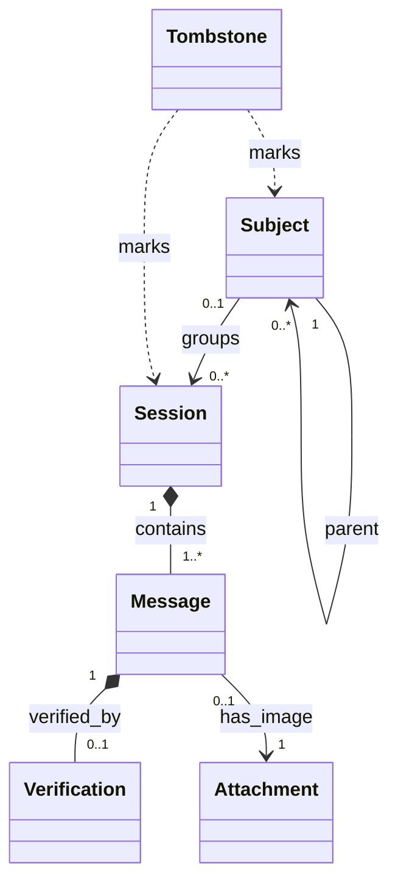
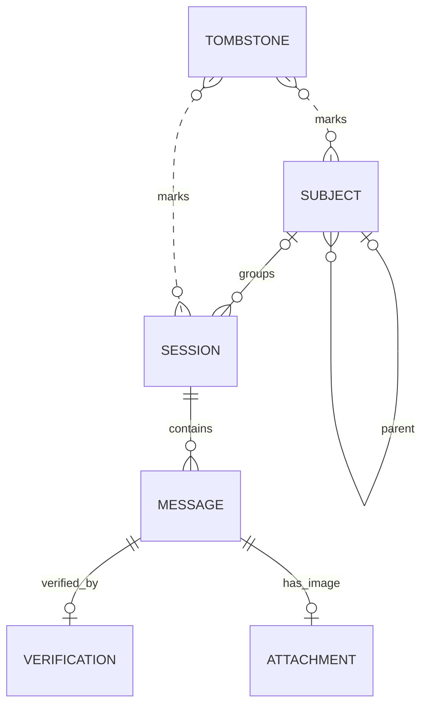

# Spore 手机端 · 系统详细设计 PPT 纲要（作业10）

> 本文件是 PPT 的**唯一事实源**：页序、文案、图表语义、动效、讲稿都在这里定稿。
> 后续 open-slide 实现时，页面不得出现本文件之外的数据或结论。
>
> - 主案例：Spore-Mobile（Android，Java + XML Views + WebView 面板）
> - 辅助：MV3 扩展（网页右缘抽屉）、桌面 GUI（同款数据模型）——只在 P03 出现一次
> - 云端：只在 P12 用一页讲「可选同步怎么对账」，不展开微服务
> - 课程：信息系统 · 作业10 系统详细设计
> - 版本：v2.0 / 2026-11-23（按「以手机为主」重排）
> - 形式：20 页，16:9（1920×1080），约 12–15 分钟（含 87 秒全页视频）

---

## 0. 交付映射（老师要求 → 本稿位置）

| 作业要求 | 本稿落点 | 页面 |
|---|---|---|
| 1. PIM 类模型图元素完整、关系正确 | 手机端实体、关系、接口 | P09 P10 P11 |
| 2. 数据表字段贴合业务，主键外键合理 | E-R、关系化设计、两张表页 | P13–P16 + 附录 A |
| 3. 界面设计体现易用性原则 | 两张手机 UI 原型 + 原则映射 | P17–P19 |
| 4. 图表标注完整，配有文字说明 | 每图都有图号、图例、读图顺序、结论句 | P05–P18 |
| 5. 附带 AI 使用说明与修改记录 | 使用范围、三条纠错、版本表 | P20a P20b |

BCE 抽取（P04–P08）是老师单独点名要的前置工作。

---

## 1. 事实基线（写作时只引用这些）

| 事实 | 证据位置 |
|---|---|
| 手机端会话模型：`Session` 带 `id/created/updated/touched/fav/subjectId/title/status/messages` | `Spore-Mobile/.../agent/Session.java:11-40` |
| `touched` 与 `updated` 分开：改名/收藏只抬 `touched`（同步要看见），列表排序仍看 `updated` | `Session.java:14-30` |
| 消息 `Msg`：role/kind/text/think/no/title/ans/why/hasImage/imagePath/ts/verify*/tools | `Session.java:36-80` |
| 会话持久化：一会话一 JSON，`filesDir/sessions/<id>.json`；id = 时间戳，文件名序 = 时间序 | `SessionStore.java:20-45` |
| 列表只读元数据（标题/时间/收藏/科目/状态/消息数），不反序列化全部消息 | `SessionStore.java:30-60` |
| 科目表：`subjects.json` 整表一个数组；字段 id/name/parentId/sortOrder/status/created/updated；**手机 v1 恒平铺**（parentId=null） | `SubjectsStore.java:15-40` |
| 删除墓碑：`sync_tombstones.json`，一行 `{k,id,ts}`；k = `a`（会话）/`c`（科目） | `SyncTombstones.java:20-60` |
| 同步状态：`spore_sync` prefs，双游标 `pullCursor` / `pushCursor`，token 只在本机 | `SporeSyncState.java:25-50` |
| 截图服务：MediaProjection 常驻、点球直接取帧（不弹确认）、黑帧检测、冻结帧框选、裁剪 JPEG 0.82 | `CaptureService.java:44-90` |
| 答题引擎：`newCaptureTurn/loadSession/rename/delete/toggleFav/assignSubject/applyPulled/sendFollowup/verifyOnly/cancel` | `AgentEngine.java:50-170` |
| 抽屉面板高度 = 屏幕 55%，贴底、可拖动 | `AnswerPanel.java:103-114` |
| 记录页：科目 chips（未分组 + 各科目，没有「全部」）、长列表、多选底栏（全选只作用当前可见） | `assets/web/record.html:46-57`、`record.js:8-30` |
| 设置：endpoint/model/apiKey/maxToolRounds/historyLimit/fastNoThink/autoVerify/proxy/theme | `SporeSettings.java:15-32` |
| 未读红点：逐会话已读水位，点开才消，不因列表刷新清零 | `panel/UnreadDotState.java:1-40` |
| 辅助形态：MV3 扩展 Alt+S 网页框选 + 右缘抽屉；GUI 同款两阶段作答 | `Spore/README.md`、`spore-gui/README.md` |
| 宣传片：1920×1080 / 30fps / 87.06s / 19.85MB，含音轨 | ffprobe 实测 2026-11-23 |

> 云端事实只用一句：Spore-Cloud 是可选同步服务端，手机推送的会话/科目/题图在那里有一份远程副本；网关、用户服务、内容服务的端口与模块**不进 PPT**。

---

## 2. 视觉与动效系统（全 20 页共用）

> 已确认（2026-11-23）：基调 = 纸面仪器感；类图 = B/C/E 三色语义；密度 = 图文并重；
> 主案例 = 手机端；MV3/GUI 为辅；云端一笔带过。

### 2.0 面向小白的表达规则（硬约束）

- **幻灯片正文不出现代码块、JSON、SQL、方法签名、命令行**。这些只允许出现在附录与讲稿里。
- 每个技术词第一次出现必须给「中文名 + 一句人话解释」，例：游标 = 同步书签；墓碑 = 删除标记。
- 类图与表结构保留英文名（作业要求），但每个框、每张表旁边必须有一句「它管什么」。
- 讲机制先讲「用户看到什么」，再讲「系统里怎么实现」；顺序不能反。
- 每页图后必须有一句「所以呢」，不要求观众自己推理。
- 表结构页允许出现字段名与类型（作业硬要求），但每一列都要有中文说明，禁止只堆英文。

### 2.1 画布与栅格

- 固定 1920×1080；内容安全区：左右 120px，上 96px，下 96px。
- 12 栏栅格，栏宽 120px，间距 24px；图表页可用满 1680px。
- 页脚固定：左「Spore Mobile · 系统详细设计」；右 `NN / 20`（用 `useSlidePageNumber()`，不手写）。

### 2.2 色彩（纸感 + 孢子粉 + 三色语义）

| Token | 值 | 用途 |
|---|---|---|
| `--paper` | `#F7F4EF` | 全页底色（不要纯白） |
| `--ink` | `#171A21` | 标题与正文 |
| `--muted` | `#6B6F78` | 注释、图例 |
| `--rule` | `#DDD6CC` | 分隔线、表格线 |
| `--accent` | `#EC4899` | 强调、当前步骤、关键数字 |
| `--accent-soft` | `#FBE3EF` | 强调底 |
| `--teal` | `#0F766E` | 第二强调（同步/云端） |
| `--b-blue` | `#2F6FED` | 边界类（B） |
| `--c-amber` | `#B45309` | 控制类（C） |
| `--e-green` | `#047857` | 实体类（E） |

图表专用：B/C/E 三色只用于类图与图例，正文不要用它们做装饰。

### 2.3 字体与字号

| 层级 | 字体 | 字号 / 行高 |
|---|---|---|
| 封面主标题 | `"Microsoft YaHei UI", "PingFang SC", sans-serif`，900 | 168px / 1.02 |
| 页面标题 | 同上，800 | 64px / 1.15 |
| 章节眉标 | 同上，600，字距 0.16em | 24px |
| 正文 | 同上，400 | 34px / 1.55 |
| 表格正文 | 同上，400 | 26px / 1.35 |
| 图注 / 脚注 | 同上，400 | 22px / 1.4 |
| 代码 / 计数 | `Consolas, "Cascadia Mono", monospace` | 24–28px |

> CJK 不加载 webfont；英文数字用 Segoe UI 视觉即可。

### 2.4 动效 DNA

- 页面切换：**只有一种**——进入页 220ms `ease-out`，透明度 0→1，位移 8px 上浮；退出页不动。
- 图表页用 `<Steps>` 分组揭示：先结构、后关系、再结论；每页 2–4 步，不逐元素弹。
- 不用的：缩放、旋转、弹跳、逐字动画、六种转场混用。
- 视频页：进入即切黑，无转场（避免与视频首帧打架）；播完淡出 240ms 进下一页。
- 讲稿全部写入 `export const notes`，与页面数组同序。

### 2.5 图片与视频资产

- 宣传片**不剪辑、不压缩、不抽帧替换**：原片 87.06s 全量播放，单独占满 P02。
- 视频放 `slides/spore-system-design/assets/spore-v2-final.mp4`；`object-fit: cover`（片源就是 16:9，不裁切）。
- 视频**不自动播放**（浏览器禁止带声音自动播放）：首帧用 `poster`，叠一个可点击播放按钮；点击后带声音播放，不循环、不显示控制条，播放中再点暂停；`onEnded` 显示「继续」提示。
- 课堂不便外放时按 `M` 静音；默认有声。
- 视频页之外的配图优先用**自绘 SVG**；实机截图只作小尺寸佐证，且裁掉宣传片字幕条。

---

## 3. 20 页总表

| # | id | 标题 | 类型 | 核心产出 |
|---|---|---|---|---|
| 01 | `cover` | Spore 手机端 · 截图搜题系统详细设计 | 封面 | 课题、课程、作者 |
| 02 | `glance` | 全页演示：Spore 是什么 | 全页视频 | 87 秒原片，不剪辑 |
| 03 | `scope` | 设计目标与系统边界 | 上下文图 | 手机为主、两端为辅、云端一句 |
| 04 | `bce-method` | BCE 怎么抽：三条识别规则 | 方法 | B/C/E 定义与计数 |
| 05 | `bce-boundary` | 边界类：用户碰得到的六个面 | 类图 | 6 个边界 |
| 06 | `bce-control` | 控制类：一次点击之后的六条流程 | 类图 | 6 个控制 |
| 07 | `bce-entity` | 实体类：关掉应用也要留下的八样 | 卡片表 | 8 个实体 |
| 08 | `sequence` | 从悬浮球到存档：一次搜题 | 时序图 | 9 步端到端 |
| 09 | `pim-class` | PIM 类模型（移动端） | 类图 | 实体 + 关系 + 多重性 |
| 10 | `pim-rules` | 四条不能破的规则 | 放大图 | 树、整体、双时间、双游标 |
| 11 | `client-api` | 三层怎么对话 | 接口表 | 界面/流程/数据契约 |
| 12 | `cloud-api` | 可选同步：手机怎么跟云端对账 | 小表 + 规则 | 只讲一次同步 |
| 13 | `er` | 数据库概念设计：E-R 图 | E-R | 8 实体 + 基数 |
| 14 | `logical` | 从对象到表 | 关系卡片 | 主外键、范式、内嵌取舍 |
| 15 | `tables-core` | 物理设计（一）：会话与消息 | 表 | session / message |
| 16 | `tables-support` | 物理设计（二）：核实与支撑 | 表 | verification / subject / attachment / tombstone / sync_state / settings |
| 17 | `ui-records` | UI 原型 A：手机搜题记录页 | 线框 | 7 个标注 |
| 18 | `ui-mobile` | UI 原型 B：悬浮球 → 框选 → 抽屉 | 三态线框 | 7 个标注 |
| 19 | `principles` | 六条易用性原则 | 映射表 | 原则 → 落点 |
| 20 | `wrap` | AI 使用说明、修改记录与交付 | 清单 | 要求 5 + 收尾 |

---

## 4. 逐页设计

### P01 `cover` 封面

- **目标**：3 秒内说清「谁、做了什么、这堂课要交什么」。
- **版面**：左对齐；左上角 24px 眉标；主标题两行；右侧留白放极简孢子图形（三圈同心弧 + 一个粉点，SVG，不用 emoji）。
- **文案**：
  - 眉标：`信息系统 · 作业10 · 系统详细设计`
  - 主标题：`Spore 孢子`
  - 副标题（72px）：`手机端截图搜题系统的详细设计`
  - 关键词行（28px，muted）：`BCE 抽取 · PIM 类图 · 接口契约 · E-R 与数据表 · UI 原型`
  - 底部：`2026-11-23　姓名 / 学号（待填）`
- **动效**：静态封面。
- **讲稿**：一句话开场——「我选的项目是自己做的手机截图搜题 App Spore，今天只讲设计：类怎么抽、数据怎么落、界面为什么这么长。」
- **验收**：主标题不换行；底部信息距下边 96px；右上无元素。

### P02 `glance` 全页视频

- **目标**：用 87 秒原片替代「产品介绍」页，让评审先看到真实交互。
- **版面**：视频 1920×1080 铺满，零边距。左上角仅一行 22px 半透明标签：`Spore · 产品演示 · 1′27″`。中央播放按钮（72px 圆，粉色描边），下方 24px 提示 `点击播放（有声）`。播放开始后覆盖层淡出。
- **内容**：`spore-v2-final.mp4` 原片全量播放；不剪辑、不加速、不循环；片尾自然黑场后显示右下角 `继续 →`。
- **动效**：进入无转场；点击播放；`onEnded` 后 240ms 淡出到 P03。播放中 `M` 静音，`Space` 暂停。
- **讲稿**：播之前只说一句「先看一遍它实际怎么用，后面全部围绕这条链路拆设计。」播完接一句「刚才那条链路，就是接下来 BCE 抽取的输入。」
- **验收**：视频文件与源文件字节一致（19,850,128 B）；poster 为 00:00:02 画面；无控制条、无进度条；`preload="metadata"`。
- **注意**：87 秒约占全场 10%，因此 P03 起每页讲稿控制在 25–40 秒；片中出现的网页/桌面只是同一设计的另外两张皮，不展开。

### P03 `scope` 设计目标与系统边界

- **目标**：先划边界：手机是主系统，MV3 与 GUI 是同一设计的另外两张皮，云端只是可选副本。
- **版面**：左侧 62% 上下文图（自绘 SVG）；右侧 38% 三条设计目标 + 一条「不做」清单 + 一行「其他端」。
- **上下文图**：
  - 中心大方框：`Spore 手机端`，内含 4 个小标签：`悬浮球` `框选` `抽屉作答` `记录`。
  - 主参与者（左）：`学生`；手机系统能力（下）：`录屏授权` `相册/文件` `通知`；外部服务（右）：`大模型 API`、`Spore-Cloud（可选）`。
  - 辅助形态（右上角，虚线小框）：`MV3 扩展`（网页右缘抽屉）、`桌面 GUI`（同款数据模型），标注 `同一套字段与交互`。
  - 云端只画一条虚线，标注 `手动同步 · 可选`。
- **右侧文案**：
  - 目标 1 `不打断`：球在屏幕上，点一下就能框选；答案从底部滑出，不跳应用。
  - 目标 2 `可追溯`：每次作答落成一条会话，保留题图、初答、核实与检索小票。
  - 目标 3 `可迁移`：本机 JSON 文件即可用；云端同步是可选增强。
  - 不做：题库检索、本地 OCR、模型训练。
  - 其他端：MV3 与 GUI 复用同一套实体与文案，不单独设计。
- **动效**：Steps 两步——中心与参与者 → 辅助端与云端虚线。
- **讲稿**：强调「系统边界 = 球、框、抽屉、记录这四件事；模型和云端都是外部」。
- **验收**：辅助端框明显小于主框；云端只有一条虚线；右侧每条不超过 2 行。

### P04 `bce-method` BCE 怎么抽

- **目标**：给出可复用的识别规则，而不是只报结果。
- **版面**：上方 3 条规则横排；下方三泳道总览（B/C/E），每道只放名称，不放细节。
- **三条规则**：
  1. 用户看得见、点得到 → **边界类**。
  2. 用户点一下之后，后台按顺序跑完的一套流程 → **控制类**。
  3. 关掉应用也还要留下来的数据 → **实体类**。
- **每类一句人话**（三列小字）：
  - 边界 = 界面：只负责显示和把点击转出去。
  - 控制 = 流程：先做什么、失败了怎么办。
  - 实体 = 档案：会话、科目、设置这些要长期保存的东西。
- **计数**：`6 边界 / 6 控制 / 8 实体`，大号数字（96px）。
- **总览泳道**：B 列 6 项、C 列 6 项、E 列 8 项，22px 中文名，三色竖条；不写英文。
- **动效**：Steps 三步，每步点亮一条规则并高亮对应泳道。
- **讲稿**：「别背定义：看得见的是边界，背后跑流程的是控制，要存下来的是实体。BCE 就是把这三件事分开。」
- **验收**：三条规则各一行；泳道名称不换行；三色仅用于竖条与数字；页面不出现英文类名。

### P05 `bce-boundary` 边界类

- **目标**：证明「界面类只做呈现与事件转发」。
- **版面**：2×3 网格，每个类一张卡：**中文名（34px 主标）+ 英文名（18px mono 副标）+ 一句话职责（26px）**。关键方法不上页面。顶部图例：`B · 边界`。底部结论句。
- **六个类**：
  | 界面（人话） | 代码里的名字 | 它负责什么 |
  |---|---|---|
  | 悬浮球 | `BallView` | 常驻屏幕上；点一下取帧，长按可拖 |
  | 框选层 | `CropOverlayView` | 冻结画面、拖框、确认或取消 |
  | 答题抽屉 | `AnswerPanel` | 从底部滑出，显示流式回答与追问 |
  | 记录页 | `RecordActivity` | 科目筛选、长列表、多选批量 |
  | 扫码页 | `QrLoginActivity` | 扫配对码，拿局域网令牌 |
  | 设置页 | `SettingsActivity` | 模型、外观、同步、日志入口 |
- **结论句**：界面只负责「显示」和「把点击转出去」，不判断业务，也不直接读写文件。
- **动效**：Steps 两步——先 6 张卡，再压暗卡片、点亮结论句。
- **讲稿**：举框选层：它只知道一个矩形和「确认/取消」，不知道题目、模型、科目是什么。
- **验收**：卡片底边距一致；结论句在 1080 内；卡片上不出现方法名与代码。

### P06 `bce-control` 控制类

- **目标**：说明每个用例对应一条控制链，且控制类可替换。
- **版面**：2×3 网格 + 顶部一句「控制类不碰界面，界面不碰流程」。每卡：中文流程名（34px）+ 英文名（18px）+ 一句话职责（26px）。
- **六个类**：
  | 流程（人话） | 代码里的名字 | 它负责什么 |
  |---|---|---|
  | 截图服务 | `CaptureService` | 常驻取帧、冻结画面、裁剪落盘 |
  | 答题引擎 | `AgentEngine` | 初答 → 联网核实，支持追问与取消 |
  | 会话仓库 | `SessionStore` | 一会话一文件，读写、删除、元数据 |
  | 科目仓库 | `SubjectsStore` | 科目表的增删改，整表原子写 |
  | 同步引擎 | `SyncEngine` | 本机改动推上去，别处改动拉回来 |
  | 检索工具链 | `SearchChain` | 需要时查资料，给结论标来源 |
- **亮点标注**：同步引擎可以整体关掉，界面和数据都不变——这就是「单机也能用」的原因。
- **动效**：Steps 两步——六卡；再高亮「同步引擎」卡并出标注。
- **讲稿**：控制类就是「一次点击之后，后台按什么顺序干活」；它不画界面，也不直接存文件。
- **验收**：每卡三行以内；高亮只用一个粉色描边；不出现方法名与代码。

### P07 `bce-entity` 实体类

- **目标**：给出实体清单与「每个抽屉里放什么」。
- **版面**：8 张卡，4×2，每卡：**中文名（32px）+ 英文名（16px）+ 里面记什么（24px，一行）**。完整字段留给 P15/P16。底部一条注记。
- **八个类**：
  | 中文名 | 代码里的名字 | 里面记什么 |
  |---|---|---|
  | 会话 | `Session` | 一次搜题的完整对话与状态 |
  | 消息 | `Message` | 会话里的一句提问或回答 |
  | 核实记录 | `Verification` | 哪些结论查过、来源和结论 |
  | 科目 | `Subject` | 会话的文件夹（手机 v1 平铺） |
  | 题图 | `Attachment` | 框选出来的那张图 |
  | 删除墓碑 | `Tombstone` | 删掉的东西的「死亡证明」 |
  | 同步状态 | `SyncState` | 账号、两个书签、上次结果 |
  | 设置 | `Settings` | 模型、外观、同步开关 |
- **注记**：消息和核实记录跟着会话整体存取；墓碑不是业务数据，是为了让别的设备知道「这条删了」。
- **动效**：Steps 三步按「内容 / 辅助 / 运行」三组点亮。
- **讲稿**：实体就是「关掉应用也要留下来的东西」；界面的选中态、红点这些临时状态不算实体。
- **验收**：8 卡不溢出；英文名只做副标；注记 22px。

### P08 `sequence` 从悬浮球到存档

- **目标**：把 BCE 串成一条可验收的功能逻辑，全部用手机端动作。
- **版面**：左侧时序图（8 条生命线，宽 1500），右侧 9 步清单（宽 300，24px）。图题：`图 1 一次搜题，手机里发生了什么`。
- **生命线（全中文）**：`学生`、`悬浮球`、`截图服务`、`框选层`、`答题引擎`、`答题抽屉`、`会话仓库`、`同步（可选）`。
- **9 步**：
  1. 打开悬浮球（首次授权录屏，只授一次）。
  2. 点球，截图服务直接取一帧，不弹系统确认。
  3. 画面冻结，交给框选层。
  4. 拖框确认，裁剪成题目图。
  5. 答题引擎接手，把题目图交给模型。
  6. 抽屉从底部滑出，答案逐字显示。
  7. 需要时联网核实，并标注来源。
  8. 会话落盘：先占位，再补全，自动起名；未读红点亮起。
  9. 追问或手动核实写回同一会话；配对了才出现「立即同步」。
- **动效**：Steps 三步——生命线与 1–3、4–6、7–9 依次点亮；当前步箭头用 `--accent`，其余降为 `--rule`。
- **讲稿**：第 8 步是设计重点：先落占位文件，程序中途被杀也不会丢这次会话；内容回来后再补全。
- **验收**：箭头不交叉；编号与箭头一一对应；页面不出现英文方法名；第 9 步的同步标注为虚线。

### P09 `pim-class` PIM 类模型

- **目标**：一张图讲清移动端实体、属性、关系与多重性。
- **版面**：满宽 1720×760 类图；顶部图例（关联 / 组合 / 自关联 / 逻辑引用）；底部图题 `图 2 移动端 PIM 实体类模型`；左下角 320×110「怎么读这张图」：框 = 一类东西；线 = 有关系；`1` 和 `0..*` = 一个对多个；实心菱形 = 整体与部分。
- **类与属性**（框内第一行中文名，第二行小字英文名；属性只显示 3–5 个关键项）：
  - 内容域：`科目 Subject(name, parentId)`、`会话 Session(subjectId, title, status, fav)`、`消息 Message(role, kind, text, ts)`、`核实记录 Verification(verdict, note)`
  - 素材域：`题图 Attachment(path, mime, size)`、`删除墓碑 Tombstone(kind, targetId, ts)`
  - 运行域：`同步状态 SyncState(uid, pullCursor, pushCursor)`、`设置 Settings(endpoint, model, theme)`
- **关系**：
  - `Subject 1 ── 0..* Subject`（`parentId` 自关联；手机 v1 不展开）
  - `Subject 0..1 ── 0..* Session`（`subjectId` 为空 = 未分组）
  - `Session 1 ◆── 1..* Message`（组合：会话没了，消息就没意义）
  - `Message 1 ◆── 0..1 Verification`（组合：核实跟着那条回答）
  - `Message 0..1 ── 1 Attachment`（有截图才有题图）
  - `Tombstone ⇢ Session / Subject`（虚线，逻辑引用：只记 id，不建外键）
  - `SyncState`、`Settings` 独立（一台设备一份）
- **动效**：Steps 三步——内容域、素材域、运行域依次出现；关系线在对应域出现后再画。
- **讲稿**：先指会话说「这是唯一的内容聚合根」；再指墓碑说「它不是业务数据，是给同步看的删除证明」。
- **验收**：每个类框宽 400/440 两档；关系线不穿类名；多重性标在箭头两端；字号 ≥22px。

### P10 `pim-rules` 四条不能破的规则

- **目标**：把最容易做错的四处放大讲透。
- **版面**：2×2 四个面板，每 panel：小图（≤700×220）+ 标题 + 两条「所以不能这样」。图题：`图 3 四条不能破的规则`。
- **面板 1 科目是树，但手机只展开一层**：字段保留父子关系，GUI/云端的多级科目同步下来不丢形；手机 v1 平铺显示，避免小屏套娃。规则：不能成环；移动只改父科目；同级用序号排序。
- **面板 2 会话是一个整体**：消息和核实记录跟着会话走，整段读写。规则：一会话一文件；写入先临时文件再改名；坏文件跳过，不拖垮整个列表。
- **面板 3 两个时间戳**：`updated` 决定列表顺序，`touched` 决定要不要同步。规则：改名/收藏只抬 `touched`（要同步，但不许顶到列表最前）；正文变化两个都抬。
- **面板 4 两个游标**：`pullCursor` 管「拉到哪」，`pushCursor` 管「推到哪」。规则：拉取绝不能动推送书签，否则本机没推的改动会被永久跳过；只有「套用服务端行」时才抬推送书签。
- **动效**：Steps 四步逐面板点亮；已讲面板降到 60% 透明度。
- **讲稿**：只讲「为什么会错」：拉取顺手改推送书签，用户的本地修改会静默消失；改名只抬 `updated`，别的设备就永远看不到改名。
- **验收**：每 panel 标题 40px、正文 26px；小图不超出面板；不出现英文不变量名。

### P11 `client-api` 三层怎么对话

- **目标**：讲清「界面、流程、数据」三层怎么说话；不展示任何签名。
- **版面**：三列等高卡片（界面层 / 流程层 / 数据层），每列「它能做什么」3 条 + 「它不能做什么」1 条；下方 6 个消息 chips（一行）；底部两条约定。图题：`图 4 三层之间怎么对话`。
- **三列内容**：
  | 层 | 它能做什么 | 它不能做什么 |
  |---|---|---|
  | 界面层 | 把状态画出来；把用户动作转出去 | 不判断对错，不碰文件 |
  | 流程层 | 决定下一步；支持取消、重来、失败重试 | 不画界面，不直接存文件 |
  | 数据层 | 按条件存取；保证一次写入完整 | 不知道界面长什么样 |
- **六类消息**（chips，22px）：
  - 开始一题：题目图已收到
  - 回答片段：答案一个字一个字出来
  - 工具进度：正在查什么、查到没有
  - 核实结果：哪些结论有来源
  - 本轮完成：会话已经存好
  - 出错：失败原因 + 能不能重试
- **两条约定**：
  1. 界面永远不直接读写文件，只把「用户想干什么」交给流程层。
  2. 所有写操作都能取消；连按悬浮球不会叠成两次作答。
- **动效**：Steps 两步——三列卡片 → 消息 chips 与约定。
- **讲稿**：「接口就是三层之间的约定：界面说『用户点了确认』，流程说『我去办』，数据说『存好了』。谁都不越界。」
- **验收**：页面无代码块、无 JSON、无方法名；三列等高；chips 不换行；约定两条各一行。

### P12 `cloud-api` 可选同步：手机怎么跟云端对账

- **目标**：只讲一次同步发生什么；云端内部一笔带过。
- **版面**：左侧一张 6 行小表（占 55%）；右侧三张规则卡；顶部一行：`手机本机 → 可选服务器（同一套表的远程副本）`。图题：`图 5 一次手动同步`。
- **小表**：
  | 你看到的动作 | 背后发生什么 | 要登录吗 |
  |---|---|---|
  | 扫码配对 | 手机扫电脑上的码，拿到一张局域网通行证 | 否 |
  | 登录 | 账号口令换一张通行证 | 否 |
  | 立即同步（先推） | 把本机改动和题图成批送上去 | 是 |
  | 立即同步（再拉） | 从上次的书签继续拿 | 是 |
  | 换账号 | 两个书签清零，重新对账 | 是 |
  | 删除后同步 | 送一条「删除证明」，不送内容 | 是 |
- **三条规则卡**：
  1. **谁后改谁生效**：比较 `touched`（会话）或 `updated`（科目），严格更新才覆盖。
  2. **删除留证明**：本机删了文件，先记墓碑；同步时补一条 `deleted=1`，对面才知道要删。
  3. **两个书签分开**：拉取书签和推送书签互不覆盖；换账号必须同时清零。
- **一句话带过云端**：服务器上就是同样的会话/科目表加附件目录；网关和微服务拆分是部署细节，不属于本设计。
- **动效**：Steps 三步——小表 → 三条规则 → 云端一句话。
- **讲稿**：用一句话解释双游标：「拉取是『我看到哪了』，推送是『我送到哪了』；把前者写进后者，等于把没送出去的改动标记成已送。」
- **验收**：表格 6 行放得下；规则卡不超过 3 行/张；页面不出现端口号与模块名。

### P13 `er` 数据库概念设计：E-R 图

- **目标**：从类图过渡到数据库，只讲基数与引用。
- **版面**：满宽 E-R 图（crow's foot 记号）；左上图例：`1—N`、`0..1`、`自关联`、`逻辑引用`；底部图题 `图 6 移动端数据 E-R 图（crow's foot）`；右侧 260px 一列「读图顺序」。
- **实体与关系**：
  - `SUBJECT 1—N SUBJECT`（`parent_id`；手机 v1 平铺）
  - `SUBJECT 0..1—N SESSION`（`subject_id` 可空 = 未分组）
  - `SESSION 1—N MESSAGE`（`session_id`）
  - `MESSAGE 1—0..1 VERIFICATION`
  - `MESSAGE 1—0..1 ATTACHMENT`
  - `TOMBSTONE ⇢ SESSION / SUBJECT`（按 `kind + target_id` 逻辑指向，不建外键）
  - `SYNC_STATE`、`SETTINGS` 独立（一台设备一行）
- **读图顺序**（右侧）：先 `SUBJECT` 与 `SESSION` → 再 `MESSAGE` → 再核实与题图 → 最后墓碑与设备状态。
- **文字结论**：所有内容表最终都能追到一条会话；墓碑是唯一「故意不留外键」的表。
- **动效**：Steps 三步——实体 → 关系 → 基数标注。
- **讲稿**：强调会话的 `subject_id` 可空：未分组是一等状态，不是脏数据。
- **验收**：8 个实体不重叠；连线不穿属性区；基数符号清晰（≥18px）。

### P14 `logical` 从对象到表

- **目标**：把 8 个实体翻成 8 张表，并解释唯一的取舍。
- **版面**：左侧 6 条「表之间怎么连」的卡片；右侧两块：`三范式一句话` 与 `消息为什么可以不内嵌`。
- **六条关系**（人话）：
  1. 一个科目下可以有多条会话；会话也可以不属于任何科目。
  2. 科目可以套科目；手机 v1 只显示一层，字段保留。
  3. 一条会话下有多条消息，按顺序编号。
  4. 一条回答最多有一条核实记录。
  5. 一条消息最多有一张题图。
  6. 删除墓碑按「类型 + id」指向会话或科目，不建外键。
- **三范式一句话**：每条信息只存一处；改昵称不用改会话表。八张表都满足 1NF/2NF/3NF。
- **消息为什么可以不内嵌**：手机端现在是一会话一 JSON，消息整段存；这里按作业要求把它显式成表，字段与 JSON 一一对应。好处是能按消息查询、核实记录独立；代价是写入要事务。同步仍以「会话」为最小单位，不按消息推。
- **完整性规则**：5 条（外键只指向存在的行；删除用标记；`message` 的 `(session_id, seq)` 唯一；题图路径只存相对路径；`sync_state/settings` 只有一行）。
- **动效**：Steps 两步——六条关系 → 范式与取舍。
- **讲稿**：「这页只解释一件事：为什么对象图里的组合关系，落到表里可以拆开，也可以合上；我们选了拆开，但不改变同步单位。」
- **验收**：不出现 SQL 与字段类型；六条关系每行 ≤ 30 字；结论句不重复。

### P15 `tables-core` 物理设计（一）：会话与消息

- **目标**：两张主表的字段、类型、约束一眼可查。
- **版面**：上下两张表；每张：表名 + 一句「这张表管什么」+ 列（字段/类型/约束/说明）；底部一行索引说明。图题：`表 1–2 会话与消息`。
- **`session`（会话表）**：一次搜题一行。
  | 字段 | 类型 | 约束 | 说明 |
  |---|---|---|---|
  | id | VARCHAR(32) | PK | 时间戳，字典序=时间序 |
  | subject_id | VARCHAR(32) | FK→subject, NULL | 空=未分组 |
  | title | VARCHAR(128) | NOT NULL | 默认「新会话」 |
  | status | VARCHAR(16) | NOT NULL | answering/verifying/done/error/aborted |
  | fav | TINYINT | 默认 0 | 收藏只标记、不置顶 |
  | created | BIGINT | NOT NULL | 创建时刻（毫秒） |
  | updated | BIGINT | NOT NULL | 列表排序用 |
  | touched | BIGINT | NOT NULL | 同步用（改名/收藏也抬） |
  | deleted | TINYINT | 默认 0 | 墓碑 |
- **`message`（消息表）**：一句话一行。
  | 字段 | 类型 | 约束 | 说明 |
  |---|---|---|---|
  | id | BIGINT | PK, AI | 自增 |
  | session_id | VARCHAR(32) | FK→session | 归属会话 |
  | seq | INT | NOT NULL | 会话内顺序 |
  | role | VARCHAR(12) | NOT NULL | user / assistant |
  | kind | VARCHAR(12) | 默认空 | answer / chat |
  | text | MEDIUMTEXT |  | 用户文本或追问回答 |
  | think | MEDIUMTEXT |  | 模型思考 |
  | ts | BIGINT | NOT NULL | 消息时刻 |
  | has_image | TINYINT | 默认 0 | 是否有题图 |
  | image_path | VARCHAR(255) | NULL | 相对路径 |
- **索引**：`message(session_id, seq)` 唯一；`session(subject_id, updated)`；`session(touched)` 供同步扫描。
- **动效**：Steps 两步——会话表 → 消息表与索引。
- **讲稿**：只讲两处：`updated` 和 `touched` 不是一个东西；消息的顺序用 `seq` 钉死，不靠时间戳。
- **验收**：两张表不裁切；字段行高 26px；说明列不换行。

### P16 `tables-support` 物理设计（二）：核实与支撑

- **目标**：六张支撑表一次讲完（其中两张设备表合并成一张卡），交代索引与「哪些数据不上云」。
- **版面**：左侧两张（`verification`、`subject`），右侧三张（`attachment`、`tombstone`、`sync_state`/`settings` 合并成一张小卡）；底部索引与容量一句。
- **`verification`（核实记录）**：`id`、`message_id FK`、`ran/skipped/pending`、`verdict`、`note`、`think`、`tools_json`；`message_id` 唯一。
- **`subject`（科目表）**：`id`、`name`、`parent_id FK`、`sort_order`、`status`、`created`、`updated`、`deleted`。
- **`attachment`（题图表）**：`id`、`message_id FK`、`path`、`mime`、`size`、`created`；文件在磁盘，表只存指针。
- **`tombstone`（删除墓碑）**：`id`、`kind`（a/c）、`target_id`、`ts`；`(kind,target_id)` 唯一。
- **`sync_state` + `settings`**：一台设备一行；`sync_state` 存 uid/api/nick/两个游标/上次结果；`settings` 存模型、主题、开关。**令牌与 API Key 只在本机 prefs，不进表、不上云。**
- **索引与容量**：`verification(message_id)` 唯一；`subject(parent_id)`；`attachment(message_id)`；`tombstone(kind,target_id)` 唯一；单用户 10^4 会话、平均 20 条消息 → 约 20 万行消息、题图约 2GB（文件系统）。
- **动效**：Steps 两步——左两张 → 右三张与索引。
- **讲稿**：强调题图只存相对路径，文件在磁盘；数据库只负责索引。
- **验收**：六张表不挤压；字段说明可读；容量公式一行写完。

### P17 `ui-records` UI 原型 A：手机搜题记录页

- **目标**：用线框证明「一屏内完成找、筛、批量、继续追问」。
- **版面**：左侧手机线框 390×844（按 1.55 放大到 604×1308 → 显示 604×1308 放不下 1080，改为 0.78 缩放：390×844 → 304×658，用两台：列表态 + 多选态），右侧 7 条标注。图题：`图 7 手机记录页线框（列表态 / 多选态）`。
- **线框分区（列表态）**：
  - 顶部标题栏 56：`搜题记录` + `批量选择`。
  - 科目 chips 48：`未分组` + 各科目（横向滚动，没有「全部」）。
  - 列表：一滑到底；每行高 96，含标题、时间、摘要两行、右侧星标、题图缩略 40×40。
  - 底部导航/手势条：留白，不放悬浮按钮（球在系统层）。
- **线框分区（多选态）**：行首单选框；底栏 `已选 N`、`全选/取消`、`收藏`、`移入科目`、`删除`。
- **标注**：
  1. chips 就是分组：未分组 + 各科目；没有「全部」，各组总和就是全部。
  2. 一滑到底，不做分页；滚动位置保留。
  3. 卡片只露两行摘要，详情页看全文。
  4. 星标只标记、不置顶（置顶会把新会话埋掉）。
  5. 长按卡片进多选；底栏「全选」只作用当前可见行。
  6. 批量移入成功即退出多选；删除有确认框。
  7. 点卡片进详情，底部输入框继续追问。
- **设计原则点题**：可发现性（批量入口常驻）、效率（chips/长列表/涂抹多选）、防错（全选范围、删除确认）。
- **动效**：Steps 两步——列表态 → 多选态与 ①–⑦。
- **讲稿**：指着 chips 说「科目是唯一的组织维度，因为搜题记录的规模用不上标签系统」。
- **验收**：两态等高；标注引线不交叉；7 条标注在右栏一屏内。

### P18 `ui-mobile` UI 原型 B：悬浮球 → 框选 → 抽屉

- **目标**：用三态线框讲清最短路径。
- **版面**：三个手机框（每个 340×720，圆角 42），间距 60；每框下方 24px 状态名；右侧 7 条标注。图题：`图 8 手机端框选作答三态线框`。
- **三态**：
  - A `悬浮球`：56dp 粉色球，贴右缘；单击取帧；长按拖动。
  - B `冻结帧 + 框选`：全屏半透明遮罩，框内原图；四角手柄 24dp；框下方尺寸提示；底部 `取消 / 确认`。
  - C `抽屉作答`：高 55% 屏、贴底、圆角 28；顶部拖动条；状态行（思考中 / 已核实）；消息气泡；工具 chips；「核实一下」；输入行；右上 `会话列表 / 收藏 / 重命名 / 删除`（SVG 线稿，不用 emoji）。
- **标注**：
  1. 悬浮球单击即取帧，不需要先打开应用。
  2. 冻结帧避免框选时内容滚动。
  3. 四角手柄 + 尺寸提示，解决小屏精确框选。
  4. 确认后抽屉从底部滑入，页面不跳转。
  5. 抽屉 55% 高度：答案在眼前，原页面仍可见。
  6. 先快答、再核实；核实结果带来源。
  7. 拖动条上滑展开、下滑收起；红点按会话已读水位点亮。
- **设计原则点题**：就近（不离开当前页）、渐进披露（先答后证）、状态可见（思考/核实/未读）。
- **动效**：Steps 三步——A → B → C 依次出现；标注随状态出现。
- **讲稿**：「手机端最重要的不是界面漂亮，是取图只要一次点击、答案不遮住题目。」
- **验收**：三框等高；抽屉视觉上约半屏；图标全部 SVG；无 emoji。

### P19 `principles` 六条易用性原则

- **目标**：把原型里的设计选择上升为原则，回应作业要求 3。
- **版面**：一张 6 行表（原则 / 定义 / 系统落点 / 原型标注），底部一段 3 行结论。图题：`表 3 易用性原则与落点`。
- **六条**：
  | 原则 | 一句话定义 | 系统落点 | 标注 |
  |---|---|---|---|
  | 就近操作 | 操作发生在注意力所在处 | 球常驻、抽屉不跳页 | P17-7, P18-1 |
  | 渐进披露 | 先给结论，再给证据 | 初答 → 核实；工具调用折叠 | P18-6 |
  | 状态可见 | 系统状态始终可感知 | 流式光标、思考块、未读点、同步结果 | P17-3, P18-5 |
  | 防错与可恢复 | 误操作可撤销、失败可重试 | 删除确认、返回取消、坏文件跳过、原子写 | P17-6 |
  | 一致性 | 同一概念同一表现 | MV3/GUI 同款术语与配色（科目/会话/收藏） | P18-7 |
  | 效率 | 高频操作最短路径 | chips 筛选、一滑到底、涂抹多选、点球即取帧 | P17-2, P17-5 |
- **结论**：界面不是「好看」，而是把一条 9 步的链路压缩到「点球 + 框选 + 看一眼」。
- **动效**：Steps 两步——表格逐行（每行 80ms）→ 结论句。
- **讲稿**：挑两条讲：防错（删除会话连题图一起删，所以必须确认）与状态可见（长任务必须让用户知道在跑）。
- **验收**：六行表格不溢出；结论句不重复表格内容。

### P20a–P20c 收尾三页：AI 使用说明 / 修改记录与交付 / 致谢

收尾原本压在一页，信息过密；现拆成三页，讲的时候一页一件事。

**P20a「AI 出了四份草稿，三处是错的」**
- **目标**：满足要求 5 的前半——说清 AI 用在哪、人拿什么把关，以及人真的抓到了什么。
- **版面**：标题即结论；通栏「产物 / AI 出的草稿 / 人拿什么核」4 行表；下接「三处初稿与源码不符」4 列表（# / AI 初稿 / 源码里的实际 / 改到哪），标题右侧标依据文件；底部一句结论。
- **分工表**：
  | 产物 | AI 出的草稿 | 人拿什么核 |
  |---|---|---|
  | 实体清单 | 8 个实体与字段初稿 | 逐字段数 `Session.java`、`SubjectsStore.java` |
  | PIM 与接口 | 分层、连线与方法名建议 | 对着三层调用点核方向、多重性、命名 |
  | 表结构 | 字段与索引候选 | 对着真实 JSON 会话文件与 prefs 核落地形态 |
  | 页面文案 | 压缩后的短句 | 统一术语，逐句核事实 |
- **纠错表（AI 初稿 → 源码里的实际 → 改到哪）**：
  | # | AI 初稿 | 源码里的实际 | 改到哪 |
  |---|---|---|---|
  | 01 | 手机端存 SQLite / MySQL | 一会话一 JSON + prefs；表页只是关系化等价 | 物理设计页加注 |
  | 02 | 会话只用一个 `updated` | 另需 `touched`：改名 / 收藏要同步，但不许顶到列表最前 | 约束页第 3 条 |
  | 03 | 拉取顺手推进推送书签 | 双游标：`pullCursor` 只管拉，`pushCursor` 只管推 | 约束页第 4 条 |
- **结论句**：AI 提高的是起草速度；事实、术语和取舍，逐条回到源码确认。
- **讲稿**：这页不是感谢 AI：四份草稿，三处错；每处都能指出源码里的实际，和改到了哪一页。

**P20b「修改记录与交付清单」**
- **目标**：满足要求 5 的后半，并让交付物逐项可对。
- **版面**：左侧修改记录表（版本 / 变更 / 日期），右侧交付清单（全部勾上）+ 一行规模：27 页 / 4 棒 / 16 分钟。
- **修改记录**：
  | 版本 | 变更 | 日期 |
  |---|---|---|
  | v0.1 | 20 页大纲、事实清单 | 11-23 10:10 |
  | v0.2 | BCE 三类清单与关系 | 11-23 10:40 |
  | v0.3 | PIM 关系、接口契约 | 11-23 11:00 |
  | v0.4 | E-R、表结构、索引 | 11-23 11:20 |
  | v0.5 | UI 两原型与原则映射 | 11-23 11:40 |
  | v1.0 | 视频页改全页、全量播放；冻结文案 | 11-23 12:00 |
  | v2.0 | 改为手机为主、MV3/GUI 为辅、云端一页带过；全稿去代码化 | 11-23 12:40 |
  | v2.1 | 新增分工页与四张章节页，扩为 25 页 | 11-23 19:00 |
  | v2.2 | 收尾拆为三页：AI 说明、记录清单、致谢，扩为 27 页 | 11-23 22:40 |
- **交付清单**：类图 / 接口说明 / E-R 图 / 数据表结构 / 2 张 UI 原型 / 设计说明 / AI 说明与修改记录。
- **讲稿**：版本表最后一行就是今天这次改动；交付五项都能指着页面说。

**P20c「谢谢」**
- **目标**：文字为主的收尾，三端仓库只做小入口。
- **版面**：深色整页，左右两栏垂直居中。左侧 `谢谢`（200px）+ 一句邀请提问 + 分隔线下的日期与课程；右侧 404px 窄列，顶部小字「三端仓库」，下面三张 185px 二维码（29 模块 × 5px，quiet zone 4 模块）摆成三角形：上排居中「手机端」，下排「MV3 扩展」+「桌面端」，每格下方标仓库名（`Offblink/Spore-Mobile`、`Offblink/Spore`、`Offblink/Spore-GUI`）。
- **动效**：静态；不要逐条弹。
- **讲稿**：「三端仓库的二维码都在这一页：手机、MV3、桌面；设计稿到此结束，欢迎提问。」
- **验收**：三页各自不溢出；三张二维码按渲染尺寸裁切都能解码回各自仓库地址；页面不出现「待补」。

---

## 5. 图形规格

> **渲染决策**：不用 Mermaid 默认布局出图（节点尺寸、字体、走线不可控，1920 画布上会糊）。
> Mermaid 只作为**语义校对源**保留在附录 C；正式图用**内联 SVG**（open-slide 页面里直接写 `<svg>`，无外部依赖）。

### 5.1 统一图元

- 类框：圆角 14，白底 `#FFFFFF`，描边 2px；类名区高 44px，底色 = 语义色 8% 透明度；属性行 24px。
- 实体框宽：400 / 440 两档；高按属性行数：`44 + 24×n + 20`。
- 关系线：2px `#6B6F78`；组合端实心菱形 14px；多重性文字 20px，放在端点外 12px。
- 箭头：8px 实心三角；虚线 = 逻辑引用。
- 图例：右上或右下，色块 14×14 + 20px 文字。
- 每图必须有：图号、图题、图例、读图顺序（或结论句）。

### 5.2 BCE 三页（P05 / P06 / P07）

- P05：2 列 × 3 行，卡 760×200，横向间距 80，纵向 56；起点 (140, 260)。卡内：中文名 34px、英文名 18px、职责 26px。
- P06：同 P05 栅格；「同步引擎」卡加 3px 粉色描边与角标。
- P07：4 列 × 2 行，卡 380×210，列间距 40，行间距 56；起点 (140, 260)。

### 5.3 PIM 类图（P09）

- 画布区域：x 100–1820，y 210–980。
- 三列：
  - A（内容域）x=140，w=420：`Subject` y=230 h=124；`Session` y=384 h=172；`Message` y=588 h=172。
  - B（素材域）x=700，w=400：`Verification` y=230 h=148；`Attachment` y=420 h=140；`Tombstone` y=602 h=140。
  - C（运行域）x=1260，w=440：`SyncState` y=250 h=172；`Settings` y=470 h=148。
- 走线：
  - `Subject` 自关联：左边出，绕到顶边上方 40px 回到左边，标 `parentId`。
  - `Subject → Session`：A 列内竖直。
  - `Session → Message`：A 列内竖直，组合端在 `Session`。
  - `Message → Verification`：从 `Message` 右边水平进入 `Verification` 左边。
  - `Message → Attachment`：从 `Message` 右边水平进入 `Attachment` 左边（与上一条错开 40px）。
  - `Tombstone ⇢ Session`：从 `Tombstone` 左边出，虚线，箭头指向 `Session` 右边，标 `kind + id`。
  - `Tombstone ⇢ Subject`：沿 y=800 绕到左边，标 `逻辑引用`。
  - `SyncState`、`Settings`：不连线，右下角加一行 `一台设备一份`。
- 图例放右下（x=1420, y=820），避免与 `Settings` 冲突。

### 5.4 E-R 图（P13）

- crow's foot 记号；实体框 360×180；三列：
  - 左：`SUBJECT`（y=240）、`SESSION`（y=500）、`MESSAGE`（y=760）
  - 中：`VERIFICATION`（y=240）、`ATTACHMENT`（y=470）、`TOMBSTONE`（y=700）
  - 右：`SYNC_STATE`（y=280）、`SETTINGS`（y=540）
- 关系：`SUBJECT 1—N SUBJECT`、`SUBJECT 0..1—N SESSION`、`SESSION 1—N MESSAGE`、`MESSAGE 1—0..1 VERIFICATION`、`MESSAGE 1—0..1 ATTACHMENT`、`TOMBSTONE ⇢ SESSION/SUBJECT`。
- 实体框内只列主键、外键、3 个关键业务字段；完整字段在 P15/P16。

### 5.5 时序图（P08）

- 8 条生命线，x 间距 180；顶部参与者框 160×56；虚线到底。
- 9 条消息，y 从 300 起，每条 52px；第 8 步（落盘）加一个自调用小回环。
- 右侧编号清单与消息 y 对齐；当前步用粉色箭头 + 加粗编号。

### 5.6 Mermaid 语义源（仅校对，不渲染）





---

## 6. UI 原型绘制规格

### 6.1 P17 手机记录页

- 画两台手机：列表态 + 多选态，各 390×844 逻辑像素，显示缩放 0.72 → 281×608；两台间距 80。
- 线框风格：白底、1.5px `--rule` 描边、圆角 18；文字用灰色条块代替真实文案，仅关键处写字。
- 顶部栏 56；chips 48（胶囊 32 高）；行卡 96；底栏 56。
- 标注引线：1.5px `--accent`，端点圆点 6px；编号圆 28px。

### 6.2 P18 手机三态

- 手机框 340×720，圆角 42，边框 2px `--ink`。
- 状态 A：悬浮球直径 46（56dp 视觉缩放），位于右缘 x=300、y=340。
- 状态 B：框选矩形 180×120，四角手柄 10×10；遮罩 `rgba(23,26,33,0.55)`。
- 状态 C：抽屉高 396（55%），顶部圆角 24；消息气泡宽 260；输入行高 44。
- 三个状态用一条 2px 虚线箭头串联，箭头上方写 `点球 / 框选 / 确认`。

---

## 7. 附录 A：数据表 DDL（构建时可直接用）

> 说明：手机端**实际存储**是一会话一 JSON + `subjects.json` + `sync_tombstones.json` + prefs；
> 下面是按作业要求做的**关系化等价设计**，字段与真实 JSON 一一对应。
> 同步仍以「会话」为最小单位，不按消息推。

```sql
CREATE TABLE subject (
  id VARCHAR(32) NOT NULL,
  name VARCHAR(64) NOT NULL,
  parent_id VARCHAR(32) DEFAULT NULL,
  sort_order INT NOT NULL DEFAULT 0,
  status TINYINT NOT NULL DEFAULT 1,
  created BIGINT NOT NULL,
  updated BIGINT NOT NULL,
  deleted TINYINT NOT NULL DEFAULT 0,
  PRIMARY KEY (id),
  KEY idx_subject_parent (parent_id),
  KEY idx_subject_updated (updated),
  CONSTRAINT fk_subject_parent FOREIGN KEY (parent_id) REFERENCES subject (id)
) ENGINE=InnoDB DEFAULT CHARSET=utf8mb4 COLLATE=utf8mb4_general_ci;

CREATE TABLE session (
  id VARCHAR(32) NOT NULL,
  subject_id VARCHAR(32) DEFAULT NULL,
  title VARCHAR(128) NOT NULL DEFAULT '新会话',
  status VARCHAR(16) NOT NULL DEFAULT '',
  fav TINYINT NOT NULL DEFAULT 0,
  created BIGINT NOT NULL,
  updated BIGINT NOT NULL,
  touched BIGINT NOT NULL,
  deleted TINYINT NOT NULL DEFAULT 0,
  PRIMARY KEY (id),
  KEY idx_session_subject_updated (subject_id, updated),
  KEY idx_session_touched (touched),
  CONSTRAINT fk_session_subject FOREIGN KEY (subject_id) REFERENCES subject (id)
) ENGINE=InnoDB DEFAULT CHARSET=utf8mb4 COLLATE=utf8mb4_general_ci;

CREATE TABLE message (
  id BIGINT NOT NULL AUTO_INCREMENT,
  session_id VARCHAR(32) NOT NULL,
  seq INT NOT NULL,
  role VARCHAR(12) NOT NULL,
  kind VARCHAR(12) NOT NULL DEFAULT '',
  text MEDIUMTEXT,
  think MEDIUMTEXT,
  ts BIGINT NOT NULL,
  has_image TINYINT NOT NULL DEFAULT 0,
  image_path VARCHAR(255) DEFAULT NULL,
  PRIMARY KEY (id),
  UNIQUE KEY uk_message_seq (session_id, seq),
  CONSTRAINT fk_message_session FOREIGN KEY (session_id) REFERENCES session (id)
) ENGINE=InnoDB DEFAULT CHARSET=utf8mb4 COLLATE=utf8mb4_general_ci;

CREATE TABLE verification (
  id BIGINT NOT NULL AUTO_INCREMENT,
  message_id BIGINT NOT NULL,
  ran TINYINT NOT NULL DEFAULT 0,
  skipped TINYINT NOT NULL DEFAULT 0,
  pending TINYINT NOT NULL DEFAULT 0,
  verdict VARCHAR(16) DEFAULT NULL,
  note MEDIUMTEXT,
  think MEDIUMTEXT,
  tools_json JSON,
  PRIMARY KEY (id),
  UNIQUE KEY uk_verification_message (message_id),
  CONSTRAINT fk_verification_message FOREIGN KEY (message_id) REFERENCES message (id)
) ENGINE=InnoDB DEFAULT CHARSET=utf8mb4 COLLATE=utf8mb4_general_ci;

CREATE TABLE attachment (
  id BIGINT NOT NULL AUTO_INCREMENT,
  message_id BIGINT NOT NULL,
  path VARCHAR(255) NOT NULL,
  mime VARCHAR(32) DEFAULT NULL,
  size BIGINT DEFAULT NULL,
  created BIGINT NOT NULL,
  PRIMARY KEY (id),
  KEY idx_attachment_message (message_id),
  CONSTRAINT fk_attachment_message FOREIGN KEY (message_id) REFERENCES message (id)
) ENGINE=InnoDB DEFAULT CHARSET=utf8mb4 COLLATE=utf8mb4_general_ci;

CREATE TABLE tombstone (
  id BIGINT NOT NULL AUTO_INCREMENT,
  kind CHAR(1) NOT NULL,
  target_id VARCHAR(64) NOT NULL,
  ts BIGINT NOT NULL,
  PRIMARY KEY (id),
  UNIQUE KEY uk_tombstone_target (kind, target_id)
) ENGINE=InnoDB DEFAULT CHARSET=utf8mb4 COLLATE=utf8mb4_general_ci;

CREATE TABLE sync_state (
  id TINYINT NOT NULL,
  uid BIGINT DEFAULT NULL,
  api VARCHAR(255) DEFAULT NULL,
  nick VARCHAR(64) DEFAULT NULL,
  pull_cursor BIGINT NOT NULL DEFAULT 0,
  push_cursor BIGINT NOT NULL DEFAULT 0,
  last_sync_at BIGINT NOT NULL DEFAULT 0,
  last_up INT NOT NULL DEFAULT 0,
  last_down INT NOT NULL DEFAULT 0,
  last_msg VARCHAR(255) DEFAULT NULL,
  PRIMARY KEY (id)
) ENGINE=InnoDB DEFAULT CHARSET=utf8mb4 COLLATE=utf8mb4_general_ci;

CREATE TABLE settings (
  id TINYINT NOT NULL,
  endpoint VARCHAR(255) DEFAULT NULL,
  model VARCHAR(64) DEFAULT NULL,
  api_key VARCHAR(255) DEFAULT NULL,
  max_tool_rounds INT NOT NULL DEFAULT 5,
  history_limit INT NOT NULL DEFAULT 10,
  fast_no_think TINYINT NOT NULL DEFAULT 1,
  auto_verify TINYINT NOT NULL DEFAULT 1,
  proxy VARCHAR(255) DEFAULT NULL,
  theme VARCHAR(16) NOT NULL DEFAULT 'system',
  PRIMARY KEY (id)
) ENGINE=InnoDB DEFAULT CHARSET=utf8mb4 COLLATE=utf8mb4_general_ci;
```

> `settings.api_key` 与同步令牌在真实实现里只落本机 prefs（token 不入表）；表设计保留列仅用于说明字段归属，不参与同步。

---

## 8. 附录 B：接口签名与事件

### 8.1 手机端控制接口

| 接口 | 签名 | 语义 |
|---|---|---|
| `AgentEngine.newCaptureTurn` | `(imagePath: String, supplement: String) -> void` | 开一轮截图作答；事件异步推 |
| `AgentEngine.sendFollowup` | `(text: String) -> boolean` | 忙时拒绝并返回 false |
| `AgentEngine.verifyOnly` | `() -> boolean` | 只跑核实阶段 |
| `AgentEngine.cancel` | `() -> void` | 幂等；取消当前轮 |
| `AgentEngine.loadSession` | `(id: String) -> boolean` | 从文件装回一条会话 |
| `AgentEngine.applyPulled` | `(incoming: Session) -> boolean` | 服务端行按 LWW 套用 |
| `SessionStore.save` | `(Session) -> boolean` | 原子写（tmp + rename） |
| `SessionStore.metas` | `() -> List<Meta>` | 只读元数据，不物化消息 |
| `SubjectsStore.create/rename/remove` | `(…) -> JSONObject/boolean` | 科目增删改，整表原子写 |
| `SyncEngine.run` | `() -> SyncReport` | 一轮先推后拉 |
| `CaptureService.startCapture` | `() -> void` | 取帧 → 冻结 → 框选 → 裁剪 |

### 8.2 UI 事件（面板 ↔ 原生桥）

| 事件 | 字段 | 何时发 |
|---|---|---|
| `state` | `status, title, messages[], unread` | 面板每次刷新 |
| `delta` | `kind, text` | 流式增量 |
| `tool` | `name, status` | 检索动作 |
| `verify` | `state, verdict, note` | 核实阶段 |
| `done` | `sessionId, title, status` | 本轮结束 |
| `error` | `code, message` | 可恢复错误 |

### 8.3 同步接口（只列名字，页面不展示）

| 动作 | 接口 | 说明 |
|---|---|---|
| 登录 | `/api/auth/login` | 账号口令换通行证 |
| 我的信息 | `/api/users/me` | 确认账号与昵称 |
| 拉取 | `/api/sync/pull` | 从书签继续拿 |
| 推送 | `/api/sync/push` | 批量送会话与科目 |
| 题图上传 | `/api/sync/push-attachment` | 文件单独走 |
| 题图下载 | `/api/sync/pull-attachment` | 按相对路径取 |
| 扫码 | `/api/auth/qr/*` | 配对时用 |

### 8.4 用例 → BCE 映射

| 用例 | 边界 | 控制 | 实体 |
|---|---|---|---|
| U1 点球搜题 | 悬浮球, 框选层, 答题抽屉 | 截图服务, 答题引擎, 检索工具链 | 会话, 消息, 核实, 题图 |
| U2 记录管理 | 记录页 | 会话仓库 | 会话, 科目 |
| U3 科目管理 | 记录页 | 科目仓库 | 科目 |
| U4 可选同步 | 设置页, 答题抽屉 | 同步引擎 | 同步状态, 墓碑 |
| U5 配对登录 | 扫码页 | 同步引擎 | 同步状态, 设置 |
| U6 设置与主题 | 设置页 | （设置存取） | 设置 |

---

## 9. 附录 C：AI 使用说明（可直接贴到 P20）

- 使用工具：omp（DeepSeek 模型）+ 本地代码检索；未使用外部设计模板。
- AI 参与：实体候选、关系梳理、页面编排、文案压缩、表结构初稿。
- 人工负责：所有字段与代码逐行对账；图布局与走线；最终取舍。
- 三条纠错已写入 P20，作为「AI 不是事实源」的证据。
- 核验方式：`grep`/`Read` 定位到具体文件与行号；表结构对照 `Session.java`、`SessionStore.java`、`SubjectsStore.java`。

---

## 10. 附录 D：术语人话表（只进讲稿，不上页面）

| 词 | 人话 |
|---|---|
| 会话 | 一次搜题的完整聊天记录 |
| 科目 | 会话的文件夹；手机 v1 只有一层 |
| 墓碑 | 删除证明：东西没了，但要让别的设备知道它被删了 |
| 游标 / 书签 | 上次同步到哪儿了 |
| LWW | 谁后改谁生效 |
| 边界类 | 用户看得见的界面 |
| 控制类 | 点一下之后后台跑的流程 |
| 实体类 | 关掉应用也要留下的数据 |
| 组合 | 整体没了，部分也没意义（会话与消息） |
| 聚合根 | 一摊数据的总入口（会话） |
| 幂等 | 同一个操作做多次，结果一样 |
| 原子写 | 要么全写成功，要么保持原样，不留半个文件 |

---

## 11. 风险与待确认

1. **作业提交格式**：本稿只做 PPT 源稿。若老师要 Word/PDF，需要把 20 页内容重排成文档（图表可复用 SVG）。
2. **表设计与真实存储**：手机端实际是 JSON 文件 + prefs；P15/P16 是按作业要求做的关系化等价设计，讲稿必须点明，避免被问「代码里没有这张表」。
3. **视频声音**：87 秒原片带音轨；教室不便外放时按 `M` 静音，时长不变。
4. **仓库体积**：19.85MB 视频若进 git，建议 Git LFS；只本地演示则放 `slides/<id>/assets/`。
5. **姓名/学号/课程名**：P01 与 P20 占位，构建前替换。
6. **二维码**：P20 指向 Spore-Mobile 仓库，构建时生成并解码验证。
7. **MV3/GUI 的边界**：只在 P03 出现一次；若老师追问，口头说明「同一套实体与交互，换了一层壳」，不另开页。

---

## 12. 构建顺序（open-slide）

1. `npx @open-slide/cli init spore-system-design`（独立 deck 目录）。
2. 把本文件复制到 deck 根目录，作为 `spec.md`；新建 `slides/spore-system-design/`。
3. 资产：
   - `assets/spore-v2-final.mp4`（原片，19.85MB，不转码）；
   - `assets/poster-02.jpg`（`ffmpeg -ss 2 -i … -frames:v 1` 抽首帧，仅作 poster）；
   - 所有图直接写在 `index.tsx` 里（内联 SVG），不落独立文件。
4. 页面实现顺序：P01 → P02 → P03 → P04 → P05/P06/P07 → P08 → P09/P10 → P11/P12 → P13–P16 → P17/P18 → P19 → P20。
5. 每页完成后用 `http://localhost:5173/s/spore-system-design/preview?p=N` 在 1920×1080 下截图验收：不溢出、不换行、对比度足够。
6. `notes` 导出与 20 页同序；改页序时必须同步改 `notes`。
7. 最后整场走一遍：P02 视频播放 87s（含声音），确认 `onEnded` 能进 P03。

### 12.1 页面 id 与组件名

```
P01 Cover            P11 ClientApi
P02 GlanceVideo      P12 CloudApi
P03 Scope            P13 Er
P04 BceMethod        P14 Logical
P05 BceBoundary      P15 TablesCore
P06 BceControl       P16 TablesSupport
P07 BceEntity        P17 UiRecords
P08 Sequence         P18 UiMobile
P09 PimClass         P19 Principles
P10 PimRules         P20 Wrap
```

---

## 13. 一页话总结（给讲稿开头用）

Spore 把「点球 → 框选 → 初答 → 核实 → 存档 → 可选同步」压成一条手机上的最短链路；设计上用一个会话聚合消息与题图，用 B/C/E 三层把界面、流程、数据分开，用双时间戳与双游标保证多端不丢改动。
